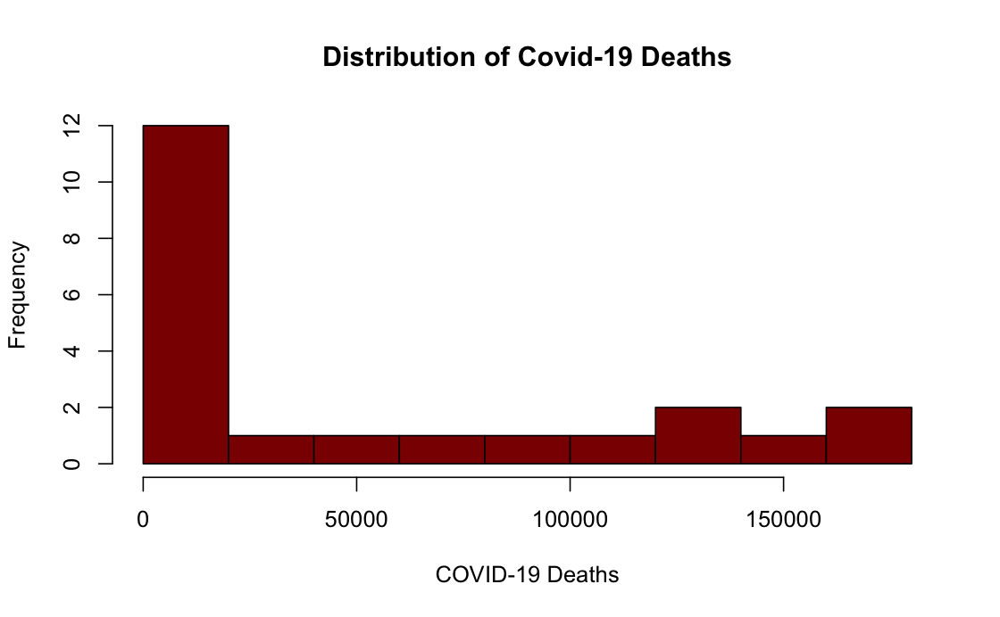
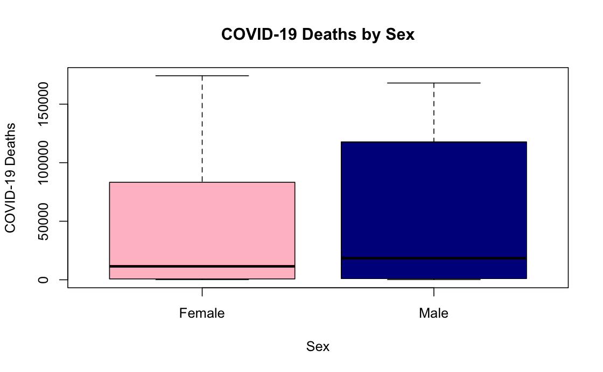
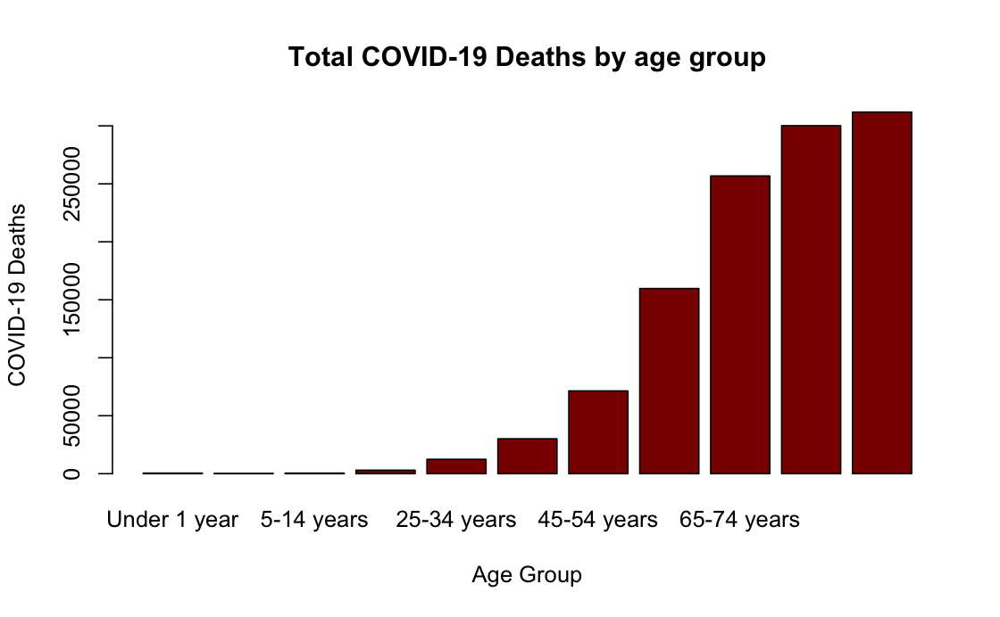
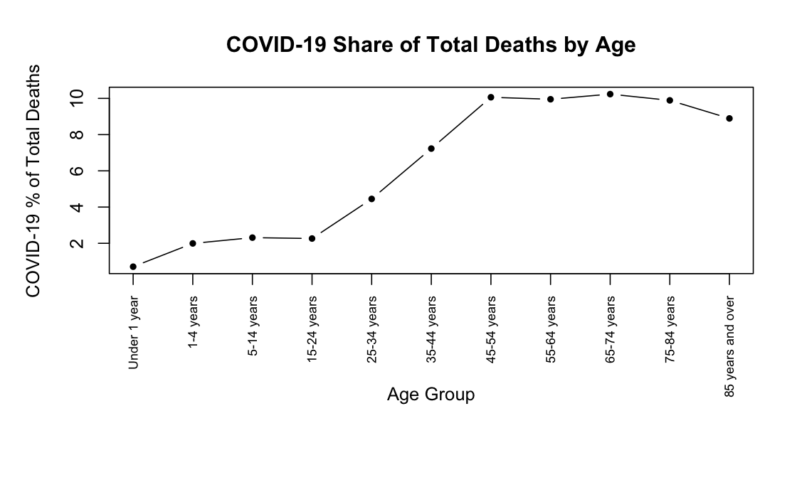
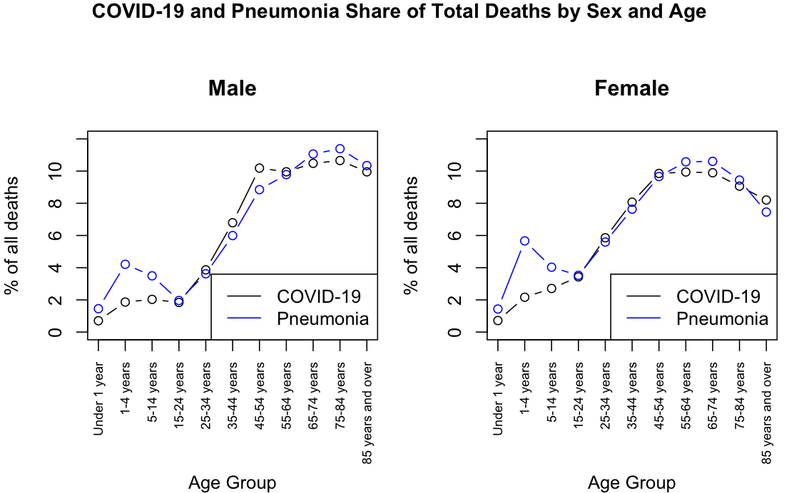
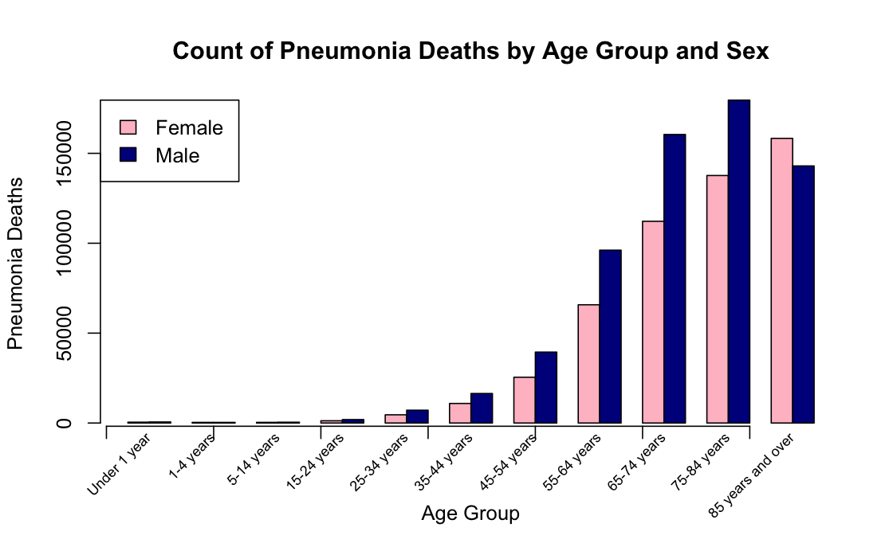
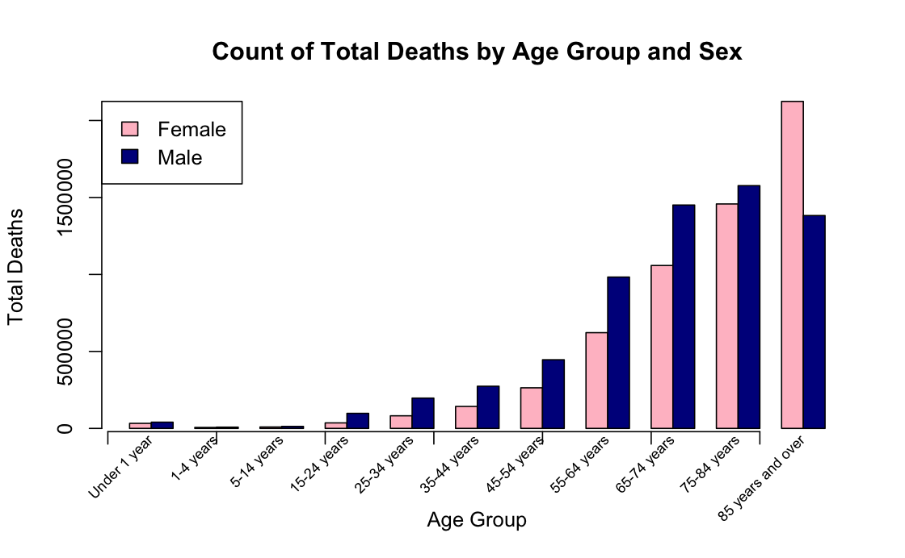

```{r setup, include=FALSE}
knitr::opts_chunk$set(echo = TRUE)
```

## GitHub Repository

Link to GitHub Repository for Access to All our Files: https://github.com/marcomanzanilla/STAT107-Project

## ABSTRACT

As our data set from the CDC shows COVID-19 provisional death counts based on age and sex, our main question that we are aiming to answer is how do different demographics (particularly age and sex) correlate with COVID-19 mortality rates. Our current base visualizations show that there is an upward trend of increasing age groups having higher COVID-19 death counts as well as a positive correlation in percentage of total deaths accounting for either deaths by COVID-19 or Pneumonia for both sexes. Additionally, males typically have higher death counts compared to females, except for the oldest age group.

## INTRODUCTION

The outbreak of the COVID-19 pandemic in 2020 was unique in its rate of spread throughout the world and how different demographics of individuals were disproportionately impacted by rates of infections and death tolls. Retrospectively assessing the data of death counts shows that the distribution of deaths was not uniform across populations. Accordingly, demographics factors like age and sex may be associated with differences in COVID-19 death rates, so examining these relationships can provide more insight into the impact of the COVID-19 pandemic. Additionally, diseases such as Pneumonia that may or may not develop alongside COVID-19 symptoms and can contribute to deaths can be used as a point of comparison.

Our central question that motivates our analysis: How do different demographics (age and sex) relate to the distribution of recorded COVID-19 and Pneumonia deaths in the United States? Our current analysis has examined death counts of COVID-19 deaths, Pneumonia deaths, and total deaths across 11 different age groups and sexes (male and female). Additionally, we also calculated and analyzed percentage of total deaths that are attributed to either COVID-19 or Pneumonia as an additional measure to see how mortality rates varied by different demographics.

This analysis will benefit the CDC, hospitals, and public health research because analysis of this data can be possibly used to determine who needs special attention based on their demographics and symptoms. We are trying to test a hypothesis because certain demographics of individuals appear to have a higher association with COVID-19 due to greater proportion of deaths, and we are trying to classify that demographic based on our analysis. Although we cannot directly conclude that their is a causation effect of certain demographics having a higher or lower likelihood of dying from these diseases, looking at the associations can open up assessing what possible contributing factors could be resulting in these higher and lower associations for certain demographics.

Thus, for our future analysis, we hope to train and test a linear regression model that can look at the current data patterns and see if certain age demographics or sexes are likely or not likely to predict higher (or lower) associations with COVID-19 or Pneumonia deaths.


## EXECUTIVE SUMMARY

* There is a significant increase in death counts by COVID-19 and Pneumonia, as well as Total Deaths, starting with the age demographic of age 50 years old and above.
* Measuring the percent of total deaths that are COVID-19 and Pneumonia respectively, for both males and females, there is an increase in percentage of COVID-19 deaths and percentage of Pneumonia deaths as age demographics increase. In particular, the proportion of deaths increases drastically during the 20 years old - 40 years old age groups and begins stabilizing around the 60 years old and above age groups.
* Males have higher deaths counts for COVID-19, Pneumonia, and total deaths compared to females up until age 85. Women have a higher mortality rate when they are older than 85 years old.
* We can infer that the correlation between age demographics and significant changes in COVID-19 deaths is more significant than the correlation between sex demographics and significant changes in COVID-19 deaths.

## DATA

* The Data available for this analysis: Provisional COVID-19 Deaths by Age and Sex
* We retrieved this dataset from the CDC.gov website. The data comes from the United States.
* There are 16 variables and 137700 Observations available.
* Variables of Interest: Sex, Age Groups, Total Deaths, COVID-19 Deaths, Pneumonia Deaths
Steps for Data Cleaning:
1) Check how many values are missing in the dataset to know where to begin cleaning.
2) To address overlaps for rows in totals, years, months, states, genders, and the age groups, the national totals by sex and the national totals by 11 different age groups.
3) The death counts for Total Deaths, COVID-19 Deaths, Pneumonia Deaths, Pneumonia and COVID-19 Deaths were converted from character values to numeric values.
4) Rows with missing counts were removed (Used Remove(NA) function code discussed in class)
5) Recheck dataset dimensions and check if there are missing values to see if removing missing counts code worked.

Steps for Data Preprocessing: For Structure and Analysis Preparation
1) Calculated the percentage total deaths that are COVID-19 deaths, percentage total deaths that are pneumonia deaths, and the percentage of Pneumonia and COVID-19 deaths that are only pneumonia deaths.
2) Found the middle age for each of the 11 age groups so that age can be used as numeric value instead of categorical data for future analyses. 
3) The age groups were converted into factors with levels so that age groups are ordered properly for plots/graphs

* The dataset data is not simulated and was retrieved via real census on people from the CDC.
* Dataset before any cleaning and preprocessing: [Provisional_COVID-19_Deaths_by_Sex_and_Age_20261027.csv]
* Dataset preprocessing rmd file [21_Data_Processing.Rmd]
* Our fully cleaned dataset is loaded into [22.DataSaving.RData] and the dataset is called [covid_cleaned]

## VISUALIZATIONS
* To view analysis on visualizations, go to [31_Data_Visualization.Rmd] file. You are also able to knit to to PDF

We currently created 8 visualizations to assess various patterns between COVID-19 Death Counts, Pneumonia Death Counts, percentages of Total Deaths that are COVID-19 or Pneumonia Deaths, and the Age (with 11 different age groups) and Sex Demographics. In the future, we also plan on using other calculated metrics, such as the age midpoints and examining COVID-19 and Pneumonia (Combined) Deaths, to create additional analyses such as scatterplots to further help with answering our central question.

Plot 1 is a histogram of COVID-19 Death Distributions by measuring frequency. This histogram displays the overall distribution and frequency of COVID-19 Deaths counts across all filters. It highlights that the lower death counts show up as small parts whereas the high deaths show up as an outlier.

```{r plot-1, echo=FALSE, fig.cap="Histogram", fig.align="center", out.width="70%", fig.pos="H"}

```

Plot 2 is a Box Plot of COVID-19 deaths by different Age Groups. This box plot compares the median, spread and range of COVID-19 deaths between males and females. It shows variability and highlights that there does not seem to be a significant difference in COVID-19 Death counts between males and females, but males appear to have a slightly higher median and greater range, with the upper range (Q3) of COVID-19 death counts being much higher than females

```{r plot-2, echo=FALSE, fig.cap="Boxplot", fig.align="center", out.width="70%", fig.pos="H"}

```

Plot 3 is a Bar Plot of COVID-19 deaths by different Age Groups. This bar plot shows the total COVID-19 Deaths across age groups only. From the results, we can interpret there is a strong correlation with increased number of COVID-19 Deaths and older age.

```{r plot-3, echo=FALSE, fig.cap="Bar Plot", fig.align="center", out.width="70%", fig.pos="H"}

```

Plot 4 is a Line Plot for Percentage of Total Deaths that are COVID-19 Deaths. This line plot shows the percentage of COVID-19 deaths relative to total deaths across the age groups. It portrays how the percentage of deaths change with the age groups. Specifically, it shows how the percentage of deaths that are COVID-19 increases drastically during for the 20 - 40 year old age groups, and then stabilizes at a high percentage of around 10% for the age groups older than 50 years old.

```{r plot-4, echo=FALSE, fig.cap="Line Plot", fig.align="center", out.width="70%", fig.pos="H"}

```

Plot 5 shows Side-by-Side Line Plots for COVID-19 vs. Pneumonia Share of Deaths by Age and Sex. These line plots compares how much of all deaths in each age group are due to COVID-19 versus pneumonia. Sex is shown separately to see whether age and sex change which illness accounts for more deaths.

Both COVID-19 and pneumonia related deaths increase as age increases, so age has a visible effect on deaths. Sex does not appear to have a large effect between them, as the two lines follow similar patterns. However, at ages 85 and older, the shares drop for females by about 2-3% in both COVID-19 and pneumonia while males stay near 10%.

```{r plot-5, echo=FALSE, fig.cap="Side-by-Side Line Plots", fig.align="center", out.width="70%", fig.pos="H"}

```

Plots 6, 7, and 8 are the Side-by-Side Bar Plot for Male vs. Female Deaths by Age Group. Specifically, Plot 6 looks at COVID-19 Death Counts, Plot 7 looks at Pneumonia Death Counts, and Plot 8 looks at Total Death Counts.

The three graphs shows a similar trend to Plot 5, with the count of COVID-19 deaths increasing as the age group increases. However, the differences in count between males and females shows that typically males have a significantly higher death count per age group until the oldest age group of 85 years and over, where females have a higher death count than males. This difference is more prominent/significant for Plot 6 showing COVID-19 Death Counts compared to Plot 7 showing Pneumonia Death Counts, so it can be deduced that for Plot 8 showing Total Death Counts, the significantly greater number of female deaths vs male deaths in the oldest age group can be attributed to COVID-19.


```{r plot-6, echo=FALSE, fig.cap="Side-by-Side Bar Plot - COVID-19", fig.align="center", out.width="70%", fig.pos="H"}

```

```{r plot-7, echo=FALSE, fig.cap="Side-by-Side Bar Plot - Pneumonia", fig.align="center", out.width="70%", fig.pos="H"}

```

```{r plot-8, echo=FALSE, fig.cap="Side-by-Side Bar Plot - Total Deaths", fig.align="center", out.width="70%", fig.pos="H"}

```


In general, these visualizations confirm that there is a strong association between older age groups and a greater count of COVID-19 or Pneumonia deaths, showing that the age demographic is a variable of significance. Additionally, although there did not appear to be a significant difference in COVID-19 death counts between males and females, the oldest age group had a higher female death count than male death count, which can largely be attributed to COVID-19 rather than Pneumonia based on the total death counts. 

## ANALYSES/FUTURE WORK
* For future analyses, we may want to create additional visualizations that use variables and calculated measures that we currently have not analyzes, such as midpoint ages and Death Counts of People with Both COVID-19 and Pneumonia. 
* Our plan is to use models such as linear regression to assess if we can use the data to make predictions on whether there will be a positive or negative association for COVID-19 Death Counts and Pneumonia Death Counts based on sex and age demographics. This could possibly training and testing a predictive model.
* Additionally, based on conclusions regarding how certain demographics are affected by COVID-19, we may also implement a classification model to determine high and low-risk demographics depending on likelihood of higher COVID-19 or Pneumonia Death Count.

## GitHub

## Summary of Individual Contribution
* Riya Ashok: Finished Visualizations: Added three side-by-side bar plots for counts of COVID-19, Pneumonia, and Total Deaths by age group for males vs females. Edited the Final Report document, added visuals.
* Marco Manzanilla: Finished up data cleaning and processing, and added readme and visualizations
* Tirth Patel: Started Data cleaning, Created Data Visualizations by adding initial 4 plots, finished up final report